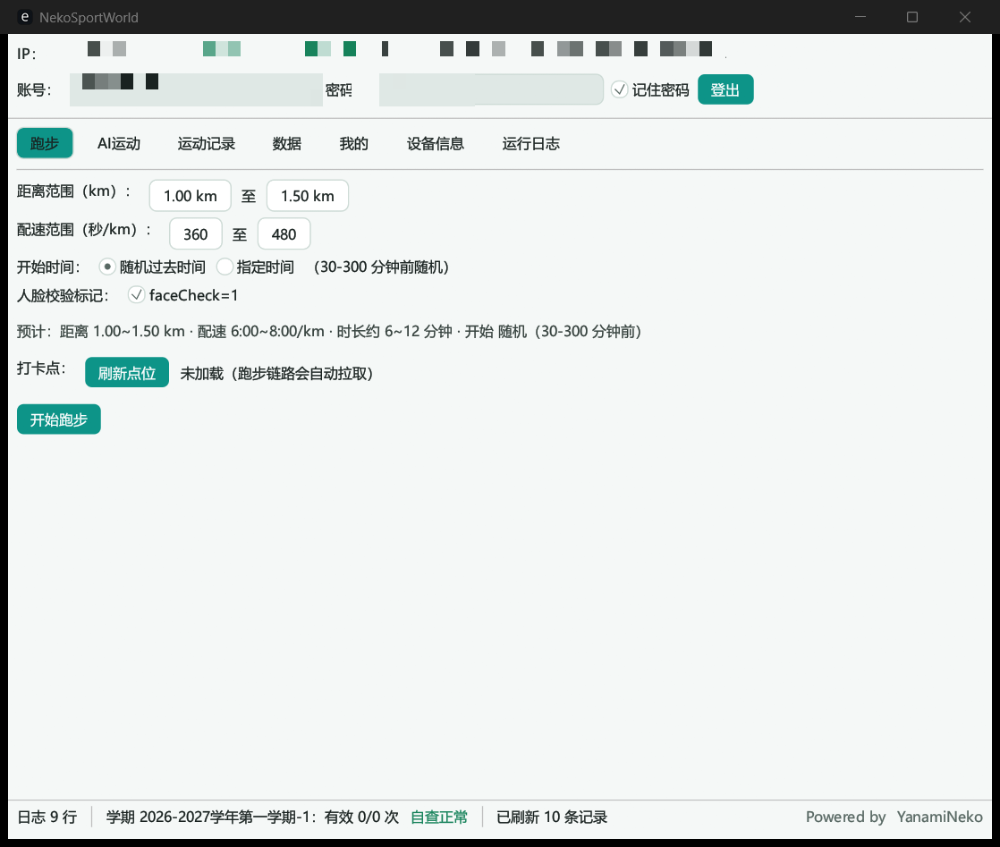

# NekoSportsWorldTool


运动世界校园版全协议自动化工具，纯 Rust 实现，桌面端 GUI / CLI 双模式，并提供 Android 客户端。

> ⚠️ 仅供学习研究，请勿用于违反学校规定的场景，使用后果自负。

## 下载

前往 [Releases](https://github.com/liming2500/NekoSportsWorldTool/releases) 下载：

| 平台 | 文件 |
| --- | --- |
| Windows x64 | `NekoSportsWorldTool-win-x64.zip` |
| Android arm64 | `NekoSportsWorldTool-android-arm64.apk` |

Windows 解压后双击 `nekosportsworldtool.exe` 即可运行；Android 直接安装 APK（首次需允许“安装未知应用”）。

## 功能

- **跑步**：一键全链（策略 → 打卡点 → 轨迹 → 提交 → OBS → 验证）。轨迹按打卡点自然生成，开始时间支持随机或指定到前 3 天；路线颜色可选全绿色或灰绿混合
- **操场模式**：支持自动拟合、200 / 300 / 400 米标准跑道、固定跑道（绕圈）与自定义圈长；绕圈模式横向漂移覆盖整条 8 道跑道
- **真实道路模式**：基于 OSM 路网与高德路线，沿校园道路生成轨迹
- **AI 运动**：任务 / 自由练习双模式，支持批量补签（前 60 天 × 多项目）
- **数据**：学期完成度、违规自查、排行榜（个人 / 班级 / 院系 × 日 / 月，室内榜、历史榜）、个人主页
- **登录**：支持人机验证自动通过
- **自动更新**：桌面端检查 / 下载 / 自替换并重启（GitHub Release 直连）；Android 下载 APK 后调起系统安装器

## 界面



## 使用

### GUI

双击 `nekosportsworldtool.exe`，在界面中登录并配置跑步参数，点击开始即可。账号、设备身份和配置保存在程序同目录的 JSON 文件中。

### CLI

```text
NekoSportsWorldTool login --user <手机号> --pass <密码> --remember
NekoSportsWorldTool run                                  # 一键跑步（--altitude 17.2 固定海拔，或 11.6-22.8 映射到区间）
NekoSportsWorldTool run --dry-run --dist 2 --pace 360 --lat 39.9 --lon 116.4
                                                         # 本地生成并校验轨迹/五点/OBS，不登录、不联网、不上传
NekoSportsWorldTool run --track-color full-green         # 全绿色（默认）；也可选 half-green-gray
NekoSportsWorldTool run --track loop:400                 # 固定跑道 400 米绕圈
NekoSportsWorldTool ai --sport 2 --score 26000           # AI 运动
NekoSportsWorldTool rank main --type 1 --sort 1          # 排行榜
NekoSportsWorldTool update [--check]                     # 自动更新（--check 仅检查不下载）
NekoSportsWorldTool template --file run.gpx              # 本地分析真实记录海拔（不会上传）
NekoSportsWorldTool help                                 # 全部命令
```

`template` 只读取本地 GPX / JSON 文件，输出采样点、海拔范围、累计上升和下降，不会登录或上传数据。

`run --dry-run` 使用本地轨迹生成器构造完整样本，校验坐标一致性、五点包装、OBS 字段和速度窗口；它不会创建登录客户端，也不会发起网络请求。`--lat` / `--lon` 可显式指定本地校验锚点，省略时使用已保存的设备锚点。

手动海拔支持三种状态：留空使用自动海拔；填写单个数字（如 `17.2`）让所有轨迹点使用固定海拔；填写区间（如 `11.6-22.8`）将海拔曲线映射到该上下限内，同时保留相对起伏。

青龙定时任务：首次手动执行 `login --remember`，之后定时执行 `run` 即可。

### Android

- 面向 Android 16（target SDK 36）的 ARM64 手机，最低 API 26。
- 点击账号、密码或数值字段会弹出系统输入法；数据保存在应用私有目录，卸载会清除。
- 自更新：关于页可检查新版本，下载 APK 后调起系统安装器。
- 首次安装需在系统设置中允许本应用“安装未知应用”。

## 构建

### Windows / 桌面端

```bash
cargo build --release                        # GUI + CLI
cargo build --release --no-default-features  # 仅 CLI
```

产物位于 `target/release/nekosportsworldtool.exe`。

### Android

需要 PowerShell 7、Rust、JDK 21 以及 Android SDK 组件（`platforms;android-36`、`build-tools;36.0.0`、`ndk;29.0.14206865`、`platform-tools`）：

```powershell
rustup target add aarch64-linux-android
./android/build.ps1 -Abi arm64-v8a -Profile release
```

产物位于 `android/build/arm64-v8a-release/NekoSportsWorldTool-arm64-v8a.apk`。详见 [android/README.md](android/README.md)。

### 测试

```bash
cargo test --all
```

推 tag（`v*`）会触发 GitHub Actions 自动构建并发布 Release（见 `.github/workflows/`）。

## 常见问题

- **提示未登录 / 401**：先执行 `login --remember`（GUI 勾选记住密码等价），会话失效会自动重登
- **10121 设备风险**：设备身份会持久化，删除 `identity.json` 等于换新设备，不要频繁删除
- **10603 点位限流**：点位接口 5 分钟限 3 次，程序内置 300s 缓存，正常使用不会触发
- **榜单为空**：当天还没有人产生有效里程，查询会自动回退最近 3 天
- **检查更新失败**：更新仅直连 GitHub，网络不通时到 [Releases](https://github.com/liming2500/NekoSportsWorldTool/releases) 手动下载
- **手动更新**：Windows 下载新的 `nekosportsworldtool.exe` 后退出软件替换旧文件；请保留 `config.json`、`identity.json`、`points_cache.json` 等配置文件
- **人机验证失败**：自动重试 3 轮，仍失败大概率是网络波动，稍后再试
- **杀软误报**：未签名编译产物可能被误报，请自行判断后加白

## 项目来源与致谢

本项目基于 [YanamiNeko/NekoSportsWorldTool](https://github.com/YanamiNeko/NekoSportsWorldTool) 修改而来，感谢原作者的开源工作。

## 许可证

[CC BY-NC 4.0](LICENSE) © YanamiNeko（禁止商用）
